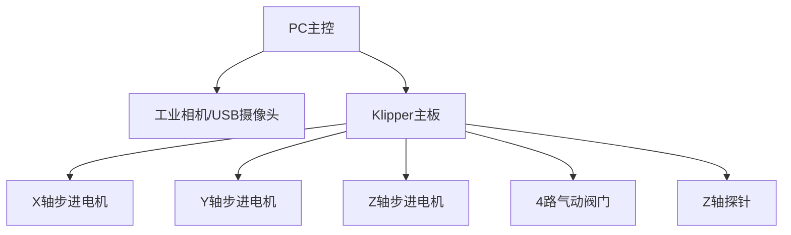
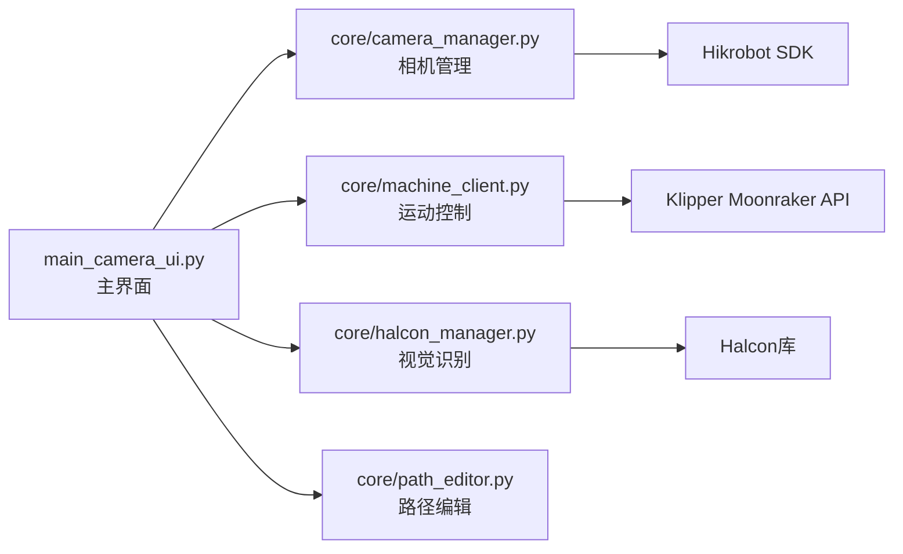
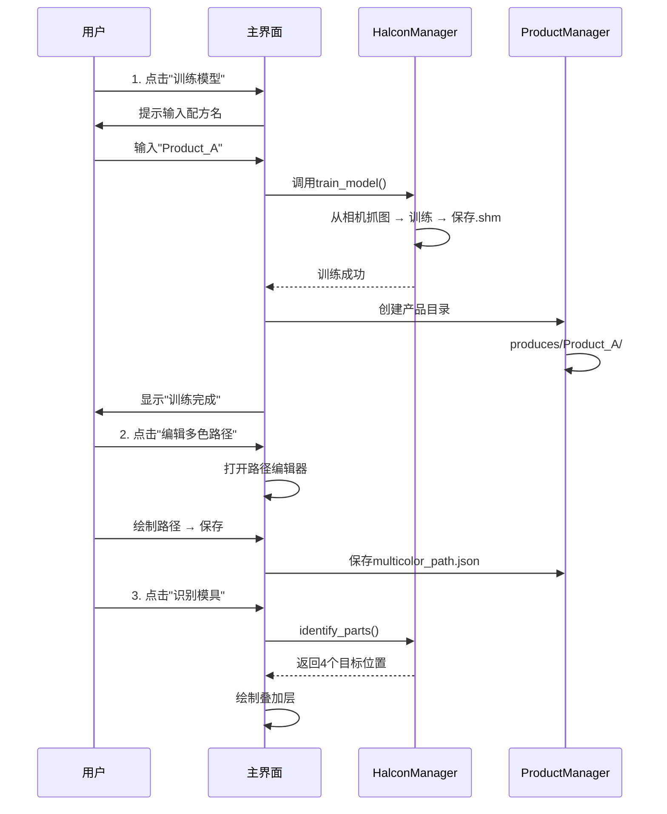
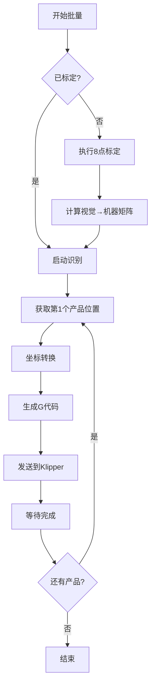

# DIY多色视觉引导点胶机 - 完整项目指南

> **适用人群**：Python初学者、嵌入式开发者、视觉引导系统学习者  
> **难度等级**：⭐⭐⭐ (中级)  
> **预计学习时间**：8-12小时

---

## 📋 目录

1. [项目概述](#1-项目概述)
2. [系统架构](#2-系统架构)
3. [环境搭建](#3-环境搭建)
4. [文件结构详解](#4-文件结构详解)
5. [核心模块深入](#5-核心模块深入)
6. [完整工作流程](#6-完整工作流程)
7. [API参考手册](#7-api参考手册)
8. [常见问题FAQ](#8-常见问题faq)

---

## 1. 项目概述

### 1.1 项目介绍

这是一个基于Python + PyQt5 + Klipper的**视觉引导多色点胶自动化系统**。

**核心功能：**
- 🎯 **视觉定位**：使用工业相机 + Halcon识别算法自动定位产品
- 🌈 **多色点胶**：支持4种颜色（A1-A4）的独立路径规划和执行
- 🤖 **运动控制**：通过Klipper固件控制3D打印机架构的XYZ三轴+阀门
- 🎨 **路径编辑**：可视化的路径规划工具，支持点和线两种模式
- 📊 **批量生产**：阵列化批量点胶，提高生产效率

**应用场景：**
- PCB板涂胶
- 电子元件封装
- 手机屏幕点胶
- 精密零件涂覆

---

## 2. 系统架构

### 2.1 硬件架构



**硬件清单：**
| 组件 | 型号/规格 | 数量 | 说明 |
|------|----------|------|------|
| 工业相机 | Hikrobot MV系列 | 1 | 或USB摄像头 |
| 主控板 | Klipper固件兼容板 | 1 | 如SKR系列 |
| 步进电机 | NEMA17 | 3 | XYZ三轴 |
| 气动阀 | 24V电磁阀 | 4 | 多色切换 |
| 探针 | BLTouch/机械探针 | 1 | Z轴对刀 |

### 2.2 软件架构



**技术栈：**
- **UI框架**：PyQt5
- **视觉库**：OpenCV + Halcon
- **通信协议**：WebSocket (Klipper) + HTTP
- **配置管理**：JSON
- **坐标变换**：NumPy + 仿射变换

---

## 3. 环境搭建

### 3.1 Python环境安装

**步骤1：创建虚拟环境**
```bash
cd DIY-Multi-Color-Vision-Guided-Dispensing-Machine
python -m venv venv
```

**步骤2：激活环境**
```bash
# Windows
venv\Scripts\activate

# Linux/Mac
source venv/bin/activate
```

**步骤3：安装依赖**
```bash
pip install -r requirements.txt
```

### 3.2 Klipper固件配置

**配置文件路径**：`/path/to/klipper/printer.cfg`

**关键配置项：**
```ini
[stepper_x]
step_pin: PE2
dir_pin: PE1
enable_pin: !PE3
microsteps: 16
rotation_distance: 40
endstop_pin: ^PA15
position_endstop: 0
position_max: 300

[stepper_y]
# ... 同X轴 ...

[stepper_z]
# ... Z轴配置 ...

# 多色阀门宏定义
[gcode_macro A1_VALVE]
gcode:
    SET_PIN PIN=valve_a1 VALUE=1
    SET_PIN PIN=valve_ctrl_a VALUE=1
    SET_PIN PIN=valve_ctrl_b VALUE=1

# 对刀探针
[probe]
pin: ^PA8
x_offset: 0
y_offset: 0
z_offset: 0
```

### 3.3 Halcon库安装（可选）

> **注意**：Halcon是商业软件，需要单独购买授权。可以先使用OpenCV模式开发。

1. 下载Halcon安装包
2. 安装到默认路径
3. 设置环境变量 `HALCONROOT`
4. 安装Python绑定：`pip install mvtec-halcon`

---

## 4. 文件结构详解

### 4.1 目录树

```
DIY-Multi-Color-Vision-Guided-Dispensing-Machine/
├── main_camera_ui.py           # 主程序入口
├── requirements.txt             # Python依赖
├── config/                      # 配置文件目录
│   ├── params.json             # 全局参数
│   ├── nozzle_offset.json      # 针头偏移
│   ├── mold2.png               # 模板图片(OpenCV)
│   └── ...
├── produces/                    # 产品配方目录
│   ├── {配方名}/
│   │   ├── reference.png       # 训练参考图
│   │   ├── {配方名}.shm        # Halcon模型
│   │   ├── multicolor_path.json # 多色路径
│   │   └── config.json         # 配方配置
├── core/                        # 核心模块
│   ├── camera_manager.py       # 相机管理器
│   ├── machine_client.py       # Klipper客户端
│   ├── halcon_manager.py       # Halcon识别
│   ├── path_editor.py          # 路径编辑器
│   ├── multicolor_path_editor.py # 多色编辑器
│   ├── mold_detector.py        # 模具检测(OpenCV)
│   ├── dry_run_dialog.py       # 空跑对话框
│   ├── batch_run_dialog.py     # 批量运行
│   └── ...
├── scripts/                     # 脚本目录
│   ├── detect_mold.hdev        # Halcon识别脚本
│   └── captures/               # 图片缓存
└── docs/                        # 文档目录
    ├── README.md
    ├── coordinate_system_manual.md
    └── complete_guide.md       # 本文档
```

### 4.2 关键文件说明

#### 📄 `main_camera_ui.py` (5500行)
**职责**：主UI窗口，整合所有功能模块

**核心类**：
- `MainWindow(QWidget)`: 主窗口类

**重要方法**：
- `init_ui()`: 初始化界面布局
- `detect_mold()`: 启动模具识别
- `on_dry_run()`: 空跑测试
- `on_batch_run()`: 批量生产

#### 📄 `core/camera_manager.py`
**职责**：管理工业相机连接和取流

```python
class CameraManager:
    def __init__(self):
        self.cam = None
        self.is_streaming = False
    
    def connect(self) -> bool:
        """连接相机"""
        # 枚举设备 → 打开 → 设置参数
        
    def start_stream(self):
        """开始取流"""
        # 配置触发模式 → 注册回调
        
    def grab_frame(self) -> np.ndarray:
        """抓取一帧"""
```

#### 📄 `core/machine_client.py`
**职责**：与Klipper通信，控制运动

```python
class MachineClient:
    def __init__(self, ip: str, port: int):
        self.ws_url = f"ws://{ip}:{port}/websocket"
        
    def connect(self) -> bool:
        """建立WebSocket连接"""
        
    def move_to(self, x: float, y: float, z: float, speed: float):
        """绝对移动"""
        gcode = f"G0 X{x} Y{y} Z{z} F{speed}"
        self.send_gcode(gcode)
        
    def home_all(self):
        """全轴归零"""
        self.send_gcode("G28")
```

#### 📄 `core/halcon_manager.py`
**职责**：Halcon形状匹配

```python
class HalconManager:
    def train_model(self, image_path: str, output_model_path: str):
        """训练新模型"""
        # 读图 → 创建形状模型 → 保存.shm
        
    def identify_parts(self, gray_image: np.ndarray):
        """识别零件位置"""
        # 加载HDev程序 → 执行识别 → 返回坐标
        return {
            "success": True,
            "matches": [
                {"row": 123.4, "col": 567.8, "angle": 0.01, "score": 0.95},
                ...
            ]
        }
```

---

## 5. 核心模块深入

### 5.1 坐标系统

本项目涉及**4种坐标系**，理解它们的转换关系是关键！

#### 5.1.1 坐标系定义


| 坐标系 | 说明 | 原点 | 单位 | 用途 |
|--------|------|------|------|------|
| **Raw** | 相机原始图像 | 左上角 | 像素 | 相机采集 |
| **Warped** | 透视校正后 | 左上角 | 像素 | 识别基准 |
| **Cell** | 单个产品区域 | 左上角 | 像素 | 路径编辑 |
| **Machine** | 机器坐标 | (0,0,0) | mm | 运动控制 |

#### 5.1.2 坐标转换代码示例

**Raw → Warped (透视变换)**
```python
import cv2
import numpy as np

# 四个角点 (左上, 右上, 右下, 左下)
src_pts = np.array([[100, 50], [700, 80], [680, 520], [120, 500]], dtype=np.float32)
dst_pts = np.array([[0, 0], [800, 0], [800, 600], [0, 600]], dtype=np.float32)

# 计算变换矩阵
M = cv2.getPerspectiveTransform(src_pts, dst_pts)

# 应用变换
warped = cv2.warpPerspective(raw_image, M, (800, 600))
```

**Warped → Cell (裁剪)**
```python
# 假设Cell 0位于 (x, y, w, h) = (50, 50, 200, 200)
cell_0 = warped_image[50:250, 50:250]
```

**像素 → 机器坐标 (标定矩阵)**
```python
# 8点标定得到的转换矩阵
vision_to_machine = np.array([
    [0.1, 0.0, 100.0],   # [a, b, tx]
    [0.0, 0.1, 50.0],    # [c, d, ty]
    [0.0, 0.0, 1.0]
])

# 像素点 -> 机器坐标
pixel_pt = np.array([120, 340, 1])  # [x_px, y_px, 1]
machine_pt = vision_to_machine @ pixel_pt  # [x_mm, y_mm, 1]

print(f"机器坐标: X={machine_pt[0]:.2f}, Y={machine_pt[1]:.2f}")
```

### 5.2 多色路径数据结构

#### 5.2.1 PathSegment类

**文件**：`core/path_segment.py`

```python
class PathSegment:
    """单个路径段"""
    
    # 颜色定义 (BGR for OpenCV)
    COLOR_BGR = [
        (0, 0, 255),    # A1: 红色
        (0, 255, 255),  # A2: 黄色
        (255, 0, 0),    # A3: 蓝色
        (0, 255, 0)     # A4: 绿色
    ]
    
    def __init__(self, seg_type: str, color: int, points: List[Tuple], dwell_ms: int):
        """
        参数:
            seg_type: 'dot' 或 'line'
            color: 0-3 (对应A1-A4)
            points: 坐标列表 [[x1,y1], [x2,y2], ...]
            dwell_ms: 停留时间(毫秒)
        """
        self.type = seg_type
        self.color = color
        self.points = points
        self.dwell_ms = dwell_ms
    
    def get_display_color_bgr(self) -> Tuple[int, int, int]:
        """获取显示颜色"""
        return self.COLOR_BGR[self.color]
```

#### 5.2.2 JSON存储格式

**文件路径**：`produces/{配方名}/multicolor_path.json`

```json
{
  "version": "1.0",
  "segments": [
    {
      "type": "line",
      "color": 0,
      "points": [[100.5, 200.3], [150.2, 250.8], [200.0, 300.0]],
      "dwell_ms": 100
    },
    {
      "type": "dot",
      "color": 1,
      "points": [[300.0, 400.0]],
      "dwell_ms": 500
    }
  ]
}
```

### 5.3 G代码生成逻辑

#### 5.3.1 多阀联动序列

**问题**：为什么一个"Tag A1"需要控制3个阀门？

**解答**：气路设计采用"主路+分路"架构
- `VALVE_A_CTRL`: 主路A开关
- `VALVE_B_CTRL`: 主路B开关  
- `A1_VALVE`: 颜色1分路开关

**正确开启顺序**（防止气压倒灌）：
```
1. A1_VALVE (开启分路)
2. VALVE_A_CTRL (开启主路A)
3. VALVE_B_CTRL (开启主路B)
```

**关闭顺序**（逆序）：
```
1. VALVE_B_CTRL (关闭主路B)
2. VALVE_A_CTRL (关闭主路A)
3. A1_VALVE (关闭分路)
```

#### 5.3.2 完整G代码示例

**输入**：一个A1颜色的线段
**输出**：
```gcode
; Segment 1: Type=line, Color=0 (A1), Dwell=100ms
G0 X100.00 Y200.00 F3000        ; 快速移动到起点上方
G1 Z5.00 F500                    ; 下降到工作高度
; Open Valves for Color 0
A1_VALVE                         ; 开启分路阀
VALVE_A_CTRL                     ; 开启主路A
VALVE_B_CTRL                     ; 开启主路B
G1 X150.00 Y250.00 F1000        ; 点胶移动
G1 X200.00 Y300.00 F1000        ; 继续点胶
; Close Valves for Color 0
VALVE_B_CTRL                     ; 关闭主路B
VALVE_A_CTRL                     ; 关闭主路A
A1_VALVE                         ; 关闭分路阀
G1 Z15.00 F500                   ; 抬升到安全高度
```

---

## 6. 完整工作流程

### 6.1 新产品配置流程



### 6.2 批量生产流程



**代码示例**：（简化版）

```python
def on_batch_run(self):
    """批量运行入口"""
    # 1. 启动识别
    results = self.halcon_manager.identify_parts(gray_image)
    
    # 2. 遍历每个识别结果
    for idx, match in enumerate(results['matches']):
        row, col = match['row'], match['col']
        
        # 3. 坐标转换
        machine_x, machine_y = self.vision_to_machine(row, col)
        
        # 4. 生成G代码
        gcode_lines = self.generate_gcode_for_product(machine_x, machine_y)
        
        # 5. 执行
        for line in gcode_lines:
            self.machine.send_gcode(line)
```

---

## 7. API参考手册

### 7.1 MachineClient类

#### 方法列表

| 方法 | 参数 | 返回值 | 说明 |
|------|------|--------|------|
| `connect()` | - | bool | 连接Klipper |
| `disconnect()` | - | - | 断开连接 |
| `send_gcode(cmd: str)` | G代码字符串 | - | 发送命令 |
| `move_to(x, y, z, speed)` | 坐标+速度 | - | 绝对移动 |
| `jog(axis, distance, speed)` | 轴+距离 | - | 相对移动 |
| `home_all()` | - | - | 全轴归零 |
| `get_position()` | - | (x,y,z) | 查询位置 |

#### 使用示例

```python
from core.machine_client import MachineClient

# 创建客户端
machine = MachineClient(ip="192.168.1.100", port=7125)

# 连接
if machine.connect():
    print("连接成功")
    
    # 归零
    machine.home_all()
    
    # 移动到指定位置
    machine.move_to(x=100, y=150, z=5, speed=3000)
    
    # 相对移动
    machine.jog(axis='x', distance=10, speed=1000)
    
    # 查询当前位置
    x, y, z = machine.get_position()
    print(f"当前位置: X={x}, Y={y}, Z={z}")
```

### 7.2 HalconManager类

#### 核心方法

```python
class HalconManager:
    def train_model(self, image_path: str, output_model_path: str) -> Tuple[bool, dict]:
        """
        训练新的形状模型
        
        参数:
            image_path: 训练图片路径 (PNG/JPG)
            output_model_path: 输出.shm文件路径
            
        返回:
            (成功标志, 详细信息字典)
            
        示例:
            ok, info = halcon.train_model("ref.png", "model.shm")
            if ok:
                origin_row = info['origin_row']
                origin_col = info['origin_col']
        """
        
    def identify_parts(self, gray_image: np.ndarray) -> dict:
        """
        识别零件位置
        
        参数:
            gray_image: 灰度图 (H, W) numpy数组
            
        返回:
            {
                "success": True/False,
                "matches": [
                    {"row": 123.4, "col": 567.8, "angle": 0.01, "score": 0.95},
                    ...
                ]
            }
        """
```

### 7.3 PathSegmentList类

```python
class PathSegmentList:
    def __init__(self, segments: List[PathSegment]):
        self.segments = segments
    
    @classmethod
    def from_json_file(cls, filepath: str):
        """从JSON文件加载"""
        with open(filepath, 'r') as f:
            data = json.load(f)
        return cls.from_dict_list(data['segments'])
    
    def to_json_file(self, filepath: str):
        """保存到JSON文件"""
        data = {'version': '1.0', 'segments': [seg.to_dict() for seg in self.segments]}
        with open(filepath, 'w') as f:
            json.dump(data, f, indent=2)
    
    def get_legacy_format(self) -> Tuple[List, List]:
        """转换为旧格式 (polys, dots)"""
        polys = []
        dots = []
        for seg in self.segments:
            if seg.type == 'line':
                polys.append(np.array(seg.points))
            else:
                dots.extend(seg.points)
        return polys, np.array(dots) if dots else np.array([])
```

---

## 8. 常见问题FAQ

### Q1: 相机无法连接怎么办？

**排查步骤：**
1. 检查USB线是否插好
2. 确认MVS SDK已安装
3. 打开MVS客户端测试相机
4. 检查环境变量 `MVS_DLL_DIR`

**代码调试：**
```python
from core.camera_manager import CameraManager

cam = CameraManager()
if not cam.connect():
    print(cam.last_error)  # 查看具体错误
```

### Q2: Klipper连接失败？

**检查清单：**
- [ ] Klipper是否正常运行？
- [ ] IP地址和端口是否正确？
- [ ] 防火墙是否阻止？
- [ ] Moonraker是否启动？

**测试命令：**
```bash
# 测试WebSocket连接
curl http://192.168.1.100:7125/printer/info
```

### Q3: 识别不到模具？

**可能原因：**
1. **光照变化**：训练时和识别时光照条件不同
2. **模糊图像**：相机未对焦
3. **模型不匹配**：产品外观与训练图差异大

**解决方案：**
```python
# 调整识别参数
halcon_manager.set_match_threshold(0.7)  # 降低阈值
halcon_manager.set_angle_range((-10, 10))  # 扩大角度范围
```

### Q4: 坐标偏移怎么调整？

**8点标定流程：**
1. 点击"标定坐标"
2. 在画面上点击8个特征点
3. 手动移动机器到对应点
4. 自动计算转换矩阵

**手动微调：**
```python
# 在UI中调整视觉偏移
self.spn_vision_offset_x.setValue(2.5)  # X方向+2.5mm
self.spn_vision_offset_y.setValue(-1.0) # Y方向-1.0mm
```

### Q5: G代码没有阀门控制？

**检查要点：**
- 路径是否是多色格式？（JSON）
- `update_button_states()`是否调用？
- Klipper宏是否定义？

**验证方法：**
```python
# 打印生成的G代码
gcode_lines = dry_run_dialog.generate_gcode()
for line in gcode_lines:
    print(line)
```

---

## 9. 进阶学习

### 9.1 自定义路径算法

**示例：圆形路径生成**

```python
import numpy as np

def generate_circle_path(center_x: float, center_y: float, radius: float, num_points: int = 36):
    """生成圆形路径"""
    angles = np.linspace(0, 2*np.pi, num_points)
    points = []
    for angle in angles:
        x = center_x + radius * np.cos(angle)
        y = center_y + radius * np.sin(angle)
        points.append([x, y])
    return PathSegment(seg_type='line', color=0, points=points, dwell_ms=100)
```

### 9.2 添加新的识别算法

**创建自定义detector**:

```python
# core/custom_detector.py
class MyCustomDetector:
    def detect(self, image: np.ndarray) -> List[dict]:
        # 1. 预处理
        gray = cv2.cvtColor(image, cv2.COLOR_BGR2GRAY)
        blurred = cv2.GaussianBlur(gray, (5, 5), 0)
        
        # 2. 边缘检测
        edges = cv2.Canny(blurred, 50, 150)
        
        # 3. 轮廓查找
        contours, _ = cv2.findContours(edges, cv2.RETR_EXTERNAL, cv2.CHAIN_APPROX_SIMPLE)
        
        # 4. 过滤轮廓
        results = []
        for cnt in contours:
            area = cv2.contourArea(cnt)
            if 100 < area < 10000:  # 面积过滤
                M = cv2.moments(cnt)
                cx = int(M['m10'] / M['m00'])
                cy = int(M['m01'] / M['m00'])
                results.append({'row': cy, 'col': cx, 'area': area})
        
        return results
```

### 9.3 性能优化技巧

**1. 图像缩放加速**
```python
# 缩小图像尺寸进行识别
scale = 0.5
small_img = cv2.resize(gray, (0, 0), fx=scale, fy=scale)
results = detect(small_img)

# 坐标还原
for r in results:
    r['row'] /= scale
    r['col'] /= scale
```

**2. 多线程加速**
```python
from concurrent.futures import ThreadPoolExecutor

with ThreadPoolExecutor(max_workers=4) as executor:
    futures = [executor.submit(process_cell, cell) for cell in cells]
    results = [f.result() for f in futures]
```

---

## 10. 贡献指南

### 10.1 代码风格

遵循PEP8规范：
- 缩进：4空格
- 行宽：120字符
- 命名：snake_case (函数/变量), PascalCase (类)

### 10.2 提交Pull Request

1. Fork仓库
2. 创建功能分支：`git checkout -b feature/your-feature`
3. 提交修改：`git commit -m "Add: your feature description"`
4. 推送分支：`git push origin feature/your-feature`
5. 创建PR

### 10.3 Bug报告

请包含以下信息：
- 操作系统版本
- Python版本
- 完整错误堆栈
- 复现步骤

---

## 11. 许可证与致谢

**许可证**：MIT License

**致谢**：
- Klipper团队
- MVTec公司 (Halcon)
- OpenCV社区

**参考资料**：
- [Klipper文档](https://www.klipper3d.org/)
- [Halcon文档](https://www.mvtec.com/products/halcon)
- [PyQt5教程](https://www.riverbankcomputing.com/software/pyqt/)

---

**最后更新**：2025-01-18  
**文档版本**：v1.0  
**维护者**：项目作者
